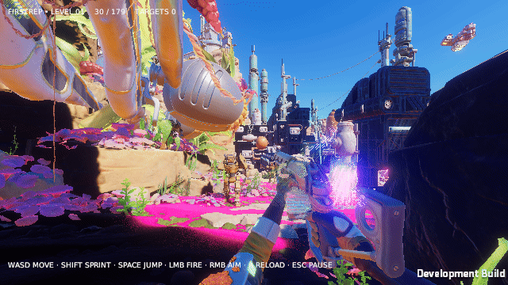

# FirstRep — Unity FPS migration checkpoint

Unity 6000.6.5f1 / HDRP 17.6 / EjoyFramework v2.1.0. This is a work-in-progress single-player adaptation of Unity FPSSample, not a finished port or a visual-fidelity acceptance build.

> EjoyFramework uses the [alone-jam fork](https://github.com/alone-jam/EjoyFramework/tree/firstrep-integration), pinned to `c36cc4fff162994ec7f05f47a2f30cc0ec4e414c`, including upstream PRs [#19](https://github.com/one2world/EjoyFramework/pull/19), [#20](https://github.com/one2world/EjoyFramework/pull/20) and [#21](https://github.com/one2world/EjoyFramework/pull/21). FirstRep now uses the full shipped Framework prefab through a configuration variant, ProcedureComponent startup, standard UI groups, official binding conventions and generated factories/accessors. The manual infrastructure composition was removed. The current target-practice slice has a usable main menu → play → return → play loop, including failed-load return and retry. Actual Unity 6000.6.5f1 consumer EditMode **9/9**, PlayMode **20/20** pass. See [closeout audit and remaining acceptance conditions](Docs/DEVELOPMENT-CLOSEOUT-20261020.md), [reuse audit and cumulative matrix](Docs/FRAMEWORK-PREFAB-MENU-20261020.md), [current evidence](Docs/framework-prefab-menu-validation-20261020.json) and [adoption policy](Docs/FRAMEWORK-ADOPTION.md). Prior Player/archive and captures do not cover this pin, prefab or menu. No current Player/bundle rebuild, rendered graphics, audio-device or performance acceptance is claimed. Release work remains paused; the previous archive is preserved.

> Historical validation on the official `a5e1ec6` pin: FirstRep EditMode **3/3** and PlayMode **5/5** pass; the latter was rerun after the application quit fix. Production AssetBundles (2 bundles, 9 assets) and a fresh Linux Player built successfully with **0 errors** on 2026-10-16. The new Player displays the scene with Bloom, ACES, grading, motion blur and subsurface scattering enabled after enabling HDRP camera NaN/Infinity cleanup. This prevents full-frame black propagation; it does not repair the remaining legacy material artifacts. A [real runtime GIF](#runtime-capture) is included below. See [current build and runtime evidence](Docs/current-player-validation.json).

See the [file/API adoption audit and actual test boundaries](Docs/FRAMEWORK-ADOPTION.md).

Before resuming, follow [storage and recovery rules](Docs/STORAGE-AND-RECOVERY.md) and run `python3 Tools/check_environment.py --verify-remote`. No per-directory retention guarantee or external artifact backup is currently confirmed. All 1,193 LFS asset payloads have been restored and SHA256-verified. The approved duplicate cache cleanup is complete, and Unity CLI plus Editor 6000.6.5f1/revision 3ff58d469c8a have been recovered. After the user completed official login and authorized Personal activation, licensing and actual fork integration tests passed. The earlier exit-198 attempt is preserved in [recovery evidence](Docs/editor-recovery-validation-20261020.json); the successful follow-up is in [current fork validation](Docs/current-fork-validation.json). The historical Player remains absent. Tracked earlier test summaries and the GIF remain historical evidence.

## Checkout and run

Install Git LFS before cloning, then run `git lfs pull`. Original binary art is stored in LFS; it must be downloaded before opening the project. Unity resolves EjoyFramework from the pinned Git URL in `Packages/manifest.json`. See [controls and build instructions](Docs/FIRST-PLAYABLE.md).

## Verification and limitations

Current fork dependency and actual consumer test evidence are published in [the adoption audit](Docs/FRAMEWORK-ADOPTION.md) and [current structured results](Docs/current-fork-validation.json). Framework fixes are committed in the pinned fork, with upstream PRs; there are no embedded framework copies or package-cache patches. Production builds use the upstream AssetBundle builder. See [bundle hashes and build history](Docs/production-validation.json).

Visual acceptance is separate from headless gameplay tests. Known migration color/material artifacts remain under investigation. The historical Player was copied and verified locally at `Deliverables/FirstRep-Linux-6000.6.5f1-b5c35ad`; that directory is currently absent. The launcher now rejects historical/unproven Players before execution; see the provenance requirements in the closeout audit. Neither a local copy nor `Builds` proves backup or platform retention. [Historical copy and hashes](Docs/persistent-player-validation.json). Actual audio-device playback remains unverified. No credentials, licenses, local caches, binaries or diagnostic authentication data are included.

## Runtime capture

Fresh Player, normal effects enabled. Real X11 mouse/keyboard input: 30→28 rounds, RELOADING, then 30/177 and movement. **8× playback** of a 96-second software Vulkan capture; native frame rate was about 0.2 fps. Pink/green materials, weapon stripes and intense highlights remain incorrect. This is a migration checkpoint, not visual-fidelity or performance acceptance. [Capture settings, hashes and state trace](Docs/runtime-capture-validation.json).

## Attribution and licenses

Original models, textures, audio and source retain their upstream licenses. Unity FPSSample is subject to the Unity Companion License for Unity-dependent projects; see [original notices](ThirdPartyNotices/FPSSample/LICENSE.md) and [full asset license](ThirdPartyNotices/FPSSample/Assets/LICENSE.md). Component notices retain their original paths beneath `ThirdPartyNotices/FPSSample`. EjoyFramework retains [its MIT license](ThirdPartyNotices/EjoyFramework/LICENSE.md). No blanket replacement license is applied. Upstream versions are recorded in [Docs/UpstreamVersions.json](Docs/UpstreamVersions.json).
